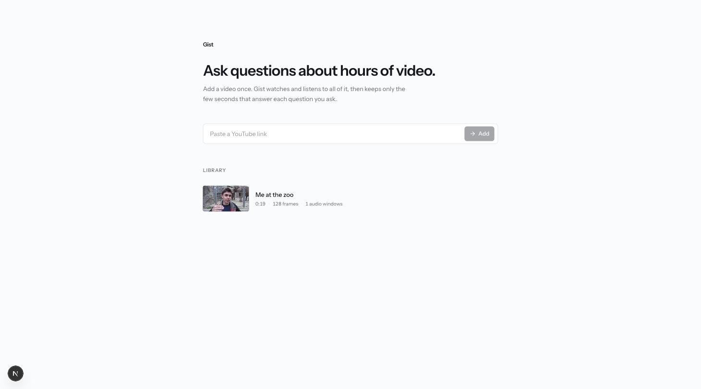
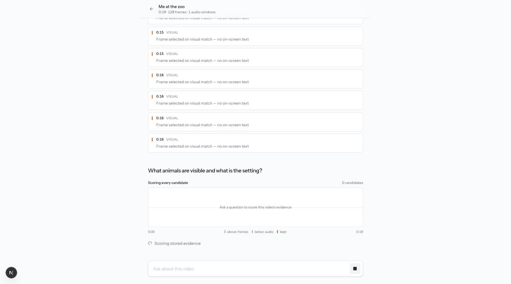
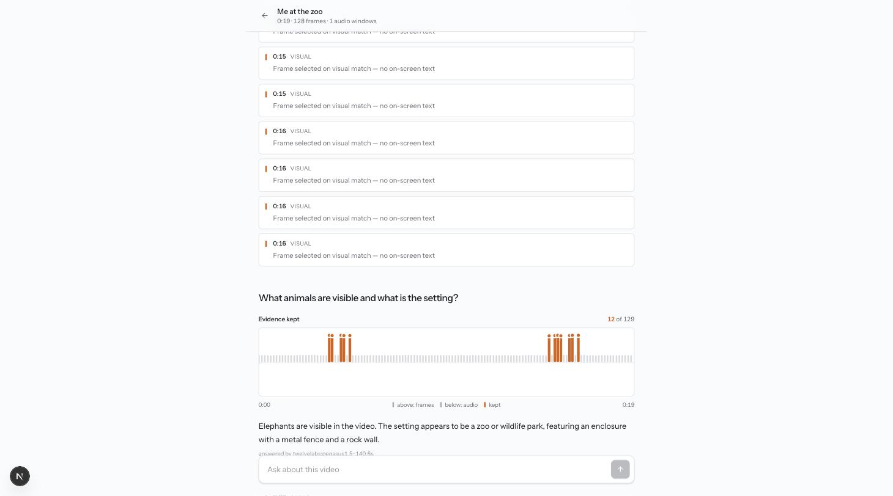
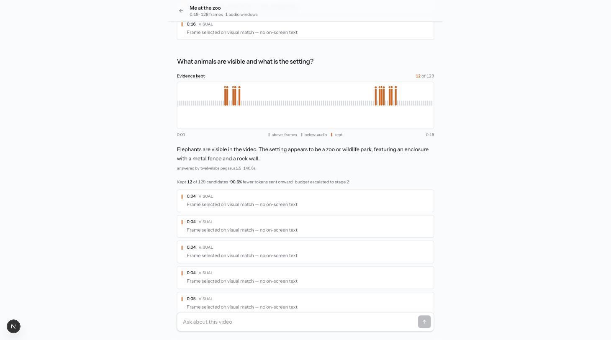
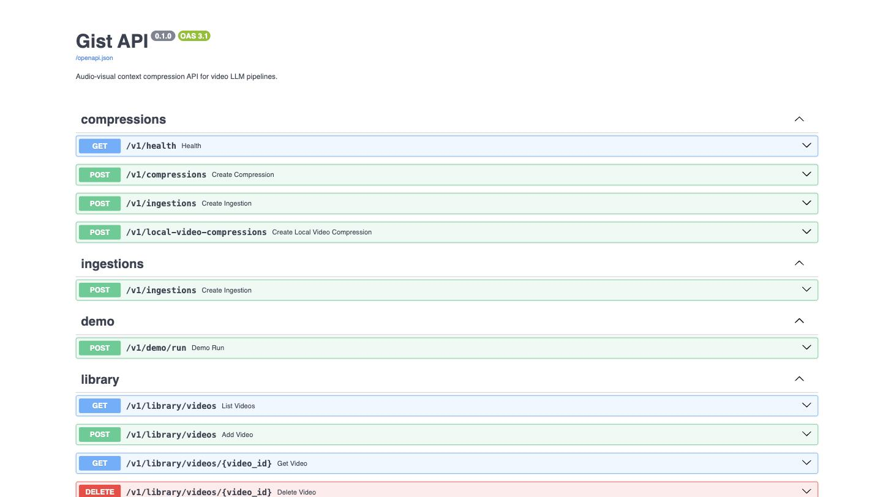

# Gist

Gist is an audio-visual context compression layer for video LLMs. The first implementation focuses on a clean, testable Gist-core runtime:

- query-aware candidate scoring
- joint visual/audio budget arbitration
- MMR-based temporal diversity
- deterministic compression presets
- API-ready response metadata for observability

The compression core stays independently testable: CLIP, CLAP, Whisper and the downstream Omni-LLM sit behind model adapters outside the selector, so the selection logic can be tested without them. Those adapters are implemented — the web demo and the benchmark runs all score real media through them.

## Capstone Submission — Final Version of the Product

Submitted for ALU Mission Capstone, *Final Version of the Product* (due 23 October 2026).

| | |
| :-- | :-- |
| **Repository** | https://github.com/thepreakerebi/gist |
| **Walkthrough video** | https://youtu.be/Q_6_BG6ncAk |
| **Technical report (PDF)** | [`docs/Gist_Technical_Report.pdf`](docs/Gist_Technical_Report.pdf) — scope alignment, technical functionality, testing and results, code quality |
| **Scope alignment table** | [`docs/scope-alignment.md`](docs/scope-alignment.md) — every planned feature, its status and the evidence for it |

**Description.** Gist is a training-free, plug-and-play audio-visual context compression layer for Omni/AV-LLMs. A user adds a video once; Gist ingests it into frames and audio windows, scores every candidate against the user's question with CLIP (visual), CLAP (sound) and Whisper (speech), arbitrates a joint visual/audio budget with z-score MMR and a temporal-diversity kernel, and passes only the surviving seconds of evidence to the answering model. The distinguishing property is *where* the compression sits: Gist drops candidates **before the encoders run**, so it reduces encoder FLOPs and peak memory rather than only decoder work. The surveyed field of training-free omni-modal methods compresses post-encoder.

### Technical requirements

| Component | Version used | Notes |
| :-------- | :----------- | :---- |
| Python | 3.12 (3.11 minimum) | `requires-python = ">=3.11"` |
| uv | 0.10.12 | dependency resolution and lockfile (`uv.lock`) |
| FFmpeg / ffprobe | 8.1 | frame sampling, audio windows, clip cutting |
| PyTorch | 2.12 (CPU / Apple Silicon); 2.6.0 + CUDA 12.4 on the GPU pod | installed by the `vision`, `audio`, `sound` and `sota` extras |
| Hugging Face Transformers | 5.12 locally; 5.13 on the GPU pod | CLIP, CLAP, Qwen2.5-Omni-7B |
| faster-whisper | base, int8 | speech transcription (CPU) |
| FastAPI / Uvicorn | FastAPI ≥ 0.115, Uvicorn ≥ 0.30 | HTTP API, OpenAPI docs at `/docs` |
| PostgreSQL + pgvector | Postgres 18.6, pgvector 0.8.6 (Neon) | video library: metadata, transcripts, 512-d CLIP/CLAP embeddings, chat history |
| Bun | 1.3 | frontend package manager and dev server |
| Next.js / React | Next.js 16.2, React 19.2, Tailwind CSS 4, shadcn | `web/` |
| Browser | Google Chrome (tested at 1440 × 900) | |

**Hardware.** The API, ingestion and scoring run on CPU: development and every web-app result used an Apple M4 Mac with 16 GB RAM. A server needs about 4 GB RAM for CLIP (1.1 GB), CLAP (1.1 GB), faster-whisper base int8 (141 MB) and the torch environment. The accuracy benchmarks run Qwen2.5-Omni-7B unquantised (fp16) and need one 24 GB GPU; all reported runs used an NVIDIA RTX 4090 24 GB rented on RunPod.

**External services.** `DATABASE_URL` (Postgres with pgvector) and `TWELVELABS_API_KEY` (the web app's answering model) go in `.env`; copy `.env.example`. No key is needed for the test suite or the CLI.

### Installation

```bash
git clone https://github.com/thepreakerebi/gist.git && cd gist
cp .env.example .env                 # fill in DATABASE_URL and TWELVELABS_API_KEY for the web app
./scripts/sync-dev.sh                # uv sync with every model extra; a bare `uv sync` prunes torch/transformers
brew install ffmpeg                  # or the platform equivalent

uv run pytest                        # 538 passed, 8 skipped (model-loading tests)
GIST_RUN_SLOW_MODEL_TESTS=1 uv run pytest   # also loads real CLIP, CLAP and Whisper: 546 passed
```

### Running

```bash
# 1. API (CPU is fine; all scoring falls back to CPU automatically)
uv run uvicorn gist.api.app:app --port 8000     # http://localhost:8000/docs

# 2. Frontend
cd web && bun install && bun dev                # http://localhost:3000

# Command line, no database or keys required
uv run gist /absolute/path/to/video.mp4 --query "what does the speaker say about pricing?" --profile gist
```

If the API is unreachable the frontend replays a baked cached run — see [Cached-run safety net](#cached-run-safety-net). The first query after start-up loads CLIP and CLAP weights on CPU, which takes about two minutes.

### Repository structure

```text
gist/
├── src/gist/
│   ├── core/          selection logic: scoring and z-scores, MMR with temporal kernel (compressor.py),
│   │                  adaptive budget, tail merging, query decomposition and intent, presets
│   ├── vision/        CLIP scorer, scene detection, OCR, spatial pruning
│   ├── audio/         CLAP scorer, Whisper transcriber, speech/sound dispatcher
│   ├── media/         FFmpeg ingestion, long-form plans, clip cutting
│   ├── candidates/    candidate generation (baseline, hierarchical, moment fusion)
│   ├── library/       once-per-video ingestion and stored-embedding query for the web app
│   ├── db/            Postgres + pgvector schema and repository
│   ├── api/           FastAPI app, routes and request/response schemas
│   ├── gateway/       answering-model adapters (TwelveLabs, OpenAI, Claude, Hugging Face, Ollama) and evidence packages
│   ├── eval/          benchmark runners, ablations, bootstrap intervals, efficiency and failure analysis
│   ├── reports/       HTML and structured report rendering
│   └── cli.py, pipeline.py, label*.py   command-line entry points
├── tests/             74 test files: unit, API, integration and gated slow model tests
├── web/               Next.js + shadcn frontend (library, chat, evidence timeline, clips)
├── scripts/           benchmark, GPU-pod and data-preparation scripts
├── results/           committed raw per-question output for every reported run
├── data/              evaluation cases, frozen splits, extraction schemas
├── notebooks/         dataset EDA notebook rendered from scripts/
├── docs/              technical report, scope alignment, dataset description, screenshots
└── pyproject.toml, uv.lock
```

### Scope alignment

Of the proposal's planned features, the five ablatable compression components, the evaluation harness, the uniform and single-modality baselines, the OmniZip head-to-head and single-GPU execution are complete. Measured wall-clock and peak memory, the OmniScope head-to-head, the held-out split and the full-size corpus are partial. VideoLLaMA2 as a second answering model and the SigLIP scorer comparison were not implemented. The full table, with the evidence and the justification for each change, is in [`docs/scope-alignment.md`](docs/scope-alignment.md).

### Designs — application interfaces

Captured from the running application (`docs/screenshots/`):

| Interface | Screenshot |
| :-------- | :--------- |
| Library — add a video by link, then ask questions of anything already ingested |  |
| Live scoring — every frame and audio window is scored against the question, streamed to the UI |  |
| Evidence kept — the timeline collapses from 129 candidates to the 12 that answer the question |  |
| Answer and evidence — the answer, its source, and every timestamped span it was allowed to see |  |
| API UI — the FastAPI/OpenAPI surface behind the frontend |  |

The run shown kept **12 of 129 candidates — 90.6% fewer tokens sent onward** — and still answered the visual question correctly, with the budget escalating to stage 2 because the first pass was not confident.

### Performance metrics

Gist is **training-free**, so there is no loss curve, no learned weights and no precision/recall over a trained classifier. The metrics that matter are answer quality held against the budget spent. Raw per-question output for each run is committed under [`results/`](results/README.md).

**Evaluation data:** see [`docs/datasets.md`](docs/datasets.md) for the full two-tier description. In short: a **subset of Video-MME's long split** (`lmms-lab/Video-MME`, 30–60 minute band) — 51 questions across 18 videos at the largest, and an 18-question / 6-video slice for most runs. The 18 are a contiguous block of the split truncated by download success, not a curated audio-visual selection; `scripts/analyse_videomme_subset.py` reconstructs and reports that from the parquet. These are not Video-MME leaderboard scores and should not be read against published Video-MME figures.

| Run | Condition | Accuracy | avg frames | avg audio windows |
| :-- | :-------- | -------: | ---------: | ----------------: |
| n=51, Qwen2.5-Omni-7B 4-bit | Full (uniform) | 25/51 (49%) | 8 | — |
| n=51, Qwen2.5-Omni-7B 4-bit | Gist-selected | 26/51 (51%) | 3.0 | 2.96 |
| n=18, Qwen2.5-Omni-7B fp16 | Full (uniform) | 5/18 (28%) | 8 | 4 |
| n=18, Qwen2.5-Omni-7B fp16 | Gist-selected | 6/18 (33%) | 2.7 | 3.2 |

Read honestly: Gist matches or edges the uniform baseline at roughly **3/8 of the visual budget**. The one-question gaps are well inside noise at these sample sizes — the pre-registered bootstrap in `gist.eval.bootstrap` exists so this is stated rather than glossed. The durable claim is structural: *matched accuracy at reduced compute*. A head-to-head against OmniZip, a per-intent heuristics ablation and a pooled-vs-split budget ablation are also committed under `results/`.

**Cost on the 18-question set.** Frame and audio-window counts are measured; GFLOPs and tokens are derived from those counts and the published Qwen2.5-Omni encoder architecture, not profiled.

| Condition | Frames | Audio windows | Encoder GFLOPs (derived) | Tokens (derived) | Saving vs dense |
| :-------- | -----: | ------------: | -----------------------: | ---------------: | --------------: |
| Dense, 64 frames | 64 | 120 | 313,345 | 102,544 | — |
| Uniform, 8 frames | 8 | 8 | 23,376 | 7,568 | 92.5% |
| Gist, as selected | 2.7 | 3.2 | 9,082 | 2,950 | 97.1% |

Against the uniform 8-frame input that reached the same accuracy, Gist needed 36.7% less encoder computation. Wall-clock time and peak GPU memory have a measurement harness (`results/efficiency-measured/`) that has not yet been run, so no measured memory figure is claimed.

**Head-to-head with OmniZip** (post-encoder, training-free, run through its own code on the same 18 questions, RTX 4090 24 GB): full context, OmniZip and Gist all scored 6/18. OmniZip's audio encoder tried to allocate about 16.8 GB on full-length videos and ran out of memory, so it only ran on 90-second clips; Gist ran the unquantised model on the full-length videos.

**Ablation on 35 curated long-video cases** (pass rate, 95% paired bootstrap intervals in `results/heuristics-ablation/`): full Gist 74.3%; without the hand-written coverage rules 71.4%; without MMR diversity (score top-k) 28.6%; visual only 45.7%; transcript only 28.6%; uniform sampling 14.3%. Selected evidence hit the reference timestamp window in 86% of cases. Temporal-ordering questions failed in every condition.

### Testing

| Strategy | What it covers | Result |
| :------- | :------------- | :----- |
| Unit | selection logic, scoring, budget ladder, tail merging, decomposition, presets (`tests/`) | 538 passed, 8 skipped, 77% line coverage |
| Integration | FastAPI endpoints via the test client; real CLIP, CLAP and Whisper loaded (`GIST_RUN_SLOW_MODEL_TESTS=1`); stored-embedding scores equal live scores to 1e-5 | 546 passed |
| Functional / system | end-to-end ingestion and question answering in the web app on 36- and 49-minute recordings | grounded answers, adaptive escalation, one documented selection failure |
| Validation / performance | benchmark runs against pre-registered thresholds of the proposal's Objective 3 | accuracy parity, 96.8% fewer encoded items than dense input, 86% timestamp hit rate, unquantised 7B on one 24 GB GPU |

Details, environments and the failures found are in the [technical report](docs/Gist_Technical_Report.pdf).

### Deployment plan

The application is fully environment-configurable already (`DATABASE_URL`, `TWELVELABS_API_KEY`, `GIST_CORS_ORIGINS`, `NEXT_PUBLIC_GIST_API`); no code changes are required to deploy. Because a hosted multimodal model answers in the demo, **Qwen2.5-Omni-7B is never deployed** — it stays offline for the measured research runs. The server needs only CLIP (1.1 GB), CLAP (1.1 GB), faster-whisper base int8 (141 MB) and the torch venv (1.1 GB): about **4 GB RAM**, plus roughly 50–100 MB of disk per ingested video at 360p.

**Tier 1 — frontend only, zero backend.** Deploy `web/` to Vercel. The cached-run snapshot in `web/public/cached-runs/` ships with the build, so the library, chat, collapse animation, evidence and clips all work with no server behind them. Free, about ten minutes, and it cannot fall over. This is the guaranteed floor and ships first.

**Tier 2 — live API,** so a panel member can paste any link. A small VPS (~4 GB RAM) running the FastAPI app under systemd, an own domain with an A record to the box, and **Caddy** terminating TLS for automatic Let's Encrypt. Caddy rather than a Cloudflare tunnel because the app streams source video and clips, and Cloudflare's free plan restricts proxying large media (ToS §2.8); Caddy keeps nothing in the byte-range path. HTTPS is mandatory, not optional — Vercel serves over HTTPS and browsers silently block calls to an `http://` API. One deployment gotcha: `LIBRARY_ROOT` is relative to the working directory, so the systemd unit must set `WorkingDirectory`.

**Timing.** Deployment is deliberately scheduled for shortly before the defense rather than now: nothing about it is on the critical path for the research, and a box provisioned months early is a box that drifts, expires or runs up cost before it is needed. Until then the demo runs locally with the two commands above.

**Operational note.** Ingestion is uncapped by choice, so on a CPU box Whisper takes 10–20 minutes on a one-hour video. Progress streams to the UI and survives a reload; keep a short video ready for anything live and let long ones run in the background.

### Video demo

**https://youtu.be/Q_6_BG6ncAk** (unlisted)

A walkthrough of the running application: ingestion, scoring, evidence selection, answers, testing and performance.

## Live Web Demo

A presentation-facing web app (`web/`, Next.js + shadcn) streams the pipeline live: type a query on any short video, watch CLIP/CLAP/Whisper score every frame and audio window against it, see the set collapse to the salient few (MMR + temporal kernel), and get an answer from the compressed evidence.

**Integrity boundary (important):** the web app's answer is produced by a hosted video model, TwelveLabs Pegasus 1.5 (`GIST_ANSWERER`, default `twelvelabs`), **for demo reliability only**, and it receives only the clips Gist selected, joined into one short video, never the whole recording. The capstone paper's measured efficiency/FLOP claims come from **Qwen2.5-Omni-7B run offline** — a closed API cannot measure encoder FLOPs, so no efficiency number in the paper comes from this API. The demo *shows the mechanism*; the paper *measures the claim*. The token figures in the demo UI are estimated from the compressed evidence, and the UI states this.

### Run locally

```bash
# API (CPU; all scoring falls back to CPU automatically)
uv run uvicorn gist.api.app:app --port 8000

# Frontend (Bun)
cd web && bun install && bun dev   # http://localhost:3000
```

Copy `.env.example` to `.env` (gitignored) and fill in `DATABASE_URL` and `TWELVELABS_API_KEY`; the API loads it at startup via python-dotenv, and real environment variables take precedence. `GIST_ANSWERER=openai|claude|extractive` switches the answerer, but the OpenAI and Claude adapters currently receive transcript text and no frames, so use TwelveLabs for visual questions. If the API is unreachable, the frontend transparently replays a pre-baked cached run (see below) so a live demo never breaks.

### Cached-run safety net

`scripts/bake_cached_run.py` captures the exact `scored` + `done` payloads a live run emits into `web/public/cached-runs/`. When the API is unreachable (dead WiFi, an API hiccup, no host running), the same UI replays a known-good run identically.

```bash
uv run python scripts/bake_cached_run.py \
  --slug paul-graham --label "Paul Graham talk (3 min)" \
  --video .gist/videos/demo-trims/paul-graham-3min.mp4 \
  --query "How do founders get startup ideas unconsciously?" \
  --answerer extractive   # use openai|claude once keys are set for a real LLM answer
```

## Structured Extraction

Gist can turn selected evidence into timestamped structured records. This is useful
for video labeling workflows such as sales-call moments, product feedback, product
launches, healthcare education moments, or product-demo indexing.

```bash
gist /absolute/path/to/video.mp4 \
  --query "find pricing objections and feature requests" \
  --processing-mode auto \
  --adaptive-budget \
  --extraction-preset sales-feedback \
  --extraction-output reports/extraction.json \
  --extraction-csv-output reports/extraction.csv
```

For the shortest product-labeling workflow, let Gist suggest the extraction preset:

```bash
gist-label /absolute/path/to/video.mp4 \
  --task "find every time prospects complain about pricing" \
  --output-dir reports/labels
```

This writes `reports/labels/extraction.json`, `reports/labels/extraction.csv`,
and `reports/labels/report.html`.
Compression-labeling runs also write `quality.json`, `quality.md`, and
`quality.html` so you can quickly see duplicate rate, weak-field rate,
timestamp coverage, confidence, and warnings.

Run a fast contract check for the product-labeling path without model or video
processing:

```bash
gist-label-smoke --output-dir reports/label-smoke
```

If you already have a `compression.json`, label it without rerunning frame,
audio, or clip processing:

```bash
gist-label-compression \
  --compression .gist/runs/video-slug/query-slug/compression.json \
  --task "find every time prospects complain about pricing" \
  --output-dir reports/labels-from-compression
```

Run the same labeling task across many existing compression files:

```bash
gist-label-batch \
  --input-root .gist/runs \
  --task "find every time prospects complain about pricing" \
  --output-dir reports/label-batch \
  --include "*yc*" \
  --query-contains pricing \
  --min-evidence 2 \
  --max-cases 20
```

Each batch run writes `batch-manifest.jsonl`. Reuse it with
`gist-label-batch --manifest reports/label-batch/batch-manifest.jsonl ...` for
reproducible reruns.

Run startup-readiness acceptance gates against a curated quality dataset:

```bash
gist-acceptance \
  --dataset data/eval/gist-acceptance.template.jsonl \
  --output reports/acceptance.json \
  --markdown-output reports/acceptance.md \
  --html-output reports/acceptance.html \
  --min-cases 3 \
  --min-pass-rate 0.9 \
  --min-avg-token-reduction-percent 90
```

The curated local suite is `data/eval/gist-acceptance.jsonl`. It should be the
default readiness check while the dataset is still small:

```bash
gist-acceptance \
  --dataset data/eval/gist-acceptance.jsonl \
  --output reports/acceptance-curated.json \
  --markdown-output reports/acceptance-curated.md \
  --html-output reports/acceptance-curated.html \
  --min-cases 10 \
  --min-pass-rate 0.9 \
  --min-avg-answer-term-recall 0.85 \
  --min-avg-evidence-relevance-rate 0.85 \
  --min-avg-timestamp-hit-rate 0.85 \
  --min-avg-grounded-evidence-rate 0.85 \
  --min-avg-token-reduction-percent 90 \
  --max-failure-count 0
```

Draft editable acceptance cases from existing runs:

```bash
gist-acceptance \
  --draft-cases-from-root .gist/runs \
  --draft-max-cases 20 \
  --draft-output data/eval/gist-acceptance.draft.jsonl
```

The first extractor is local and deterministic. It establishes the model-agnostic
contract: schema in, compressed evidence in, timestamped JSON items out. Stronger
LLM/VLM extractors can plug into the same contract later.

Built-in schemas:

- `data/extraction/sales-feedback.schema.json`: sales calls, demos, and product feedback.
- `data/extraction/customer-objections.schema.json`: objections, blockers, and concerns.
- `data/extraction/feature-requests.schema.json`: requested features and workflow gaps.
- `data/extraction/product-announcements.schema.json`: keynotes, launch videos, and demos.
- `data/extraction/meeting-decisions.schema.json`: decisions, action items, owners, and follow-ups.

The same templates are packaged under `src/gist/data/extraction` so schema
discovery works after installation, not only from a cloned repository.

List available schemas with:

```bash
gist-structured-schemas
gist-structured-schemas --json
gist-structured-schemas --presets
gist-structured-schemas --suggest "find every time prospects complain about pricing"
```

Run extraction from an existing compression file:

```bash
gist-structured-extract \
  --compression .gist/runs/video-slug/query-slug/compression.json \
  --preset sales-feedback \
  --output reports/extraction.json \
  --markdown-output reports/extraction.md \
  --html-output reports/extraction.html \
  --csv-output reports/extraction.csv
```

Use `--schema /path/to/custom.schema.json` when you need a custom schema file.
Use `--schema-name sales_feedback` when you want the exact built-in schema name
instead of the friendlier preset alias.

Use an external extractor command when you want an LLM/VLM to fill the schema:

```bash
gist-structured-extract \
  --compression .gist/runs/video-slug/query-slug/compression.json \
  --schema-name sales_feedback \
  --output reports/extraction.json \
  --extractor-command "python scripts/my_structured_extractor.py"
```

A dependency-free reference extractor is included:

```bash
gist-structured-extract \
  --compression .gist/runs/video-slug/query-slug/compression.json \
  --schema-name sales_feedback \
  --output reports/extraction.json \
  --extractor-command "python scripts/run_local_structured_extractor.py"
```

Evaluate structured extraction outputs with:

```bash
gist-extraction-eval \
  --dataset data/eval/extraction-quality.template.jsonl \
  --output reports/extraction-quality.json \
  --markdown-output reports/extraction-quality.md
```

Run a full extraction smoke check from an existing compression:

```bash
gist-extraction-smoke \
  --compression .gist/runs/video-slug/query-slug/compression.json \
  --schema data/extraction/sales-feedback.schema.json \
  --output-dir reports/extraction-smoke \
  --case-id sales-feedback-smoke \
  --expected-label "pricing objection" \
  --support-term pricing \
  --expected-start-seconds 120 \
  --expected-end-seconds 150
```

## Quickstart

```bash
./scripts/sync-dev.sh          # uv sync with every extra
uv run pytest
uv run uvicorn gist.api.app:create_app --factory --reload
```

With pip instead of uv:

```bash
python -m venv .venv
source .venv/bin/activate
pip install -e ".[dev]"
pytest
```

Optional CLIP visual scoring dependencies:

```bash
pip install -e ".[vision]"
```

Optional Whisper speech transcription dependencies:

```bash
pip install -e ".[audio]"
```

Optional CLAP sound-event scoring dependencies:

```bash
pip install -e ".[sound]"
```

Run slow model adapter tests only after installing optional dependencies:

```bash
GIST_RUN_SLOW_MODEL_TESTS=1 python -m pytest -m slow
```

For real media extraction, install FFmpeg:

```bash
brew install ffmpeg
```

## Example Request

```bash
curl -X POST http://127.0.0.1:8000/v1/compressions \
  -H "content-type: application/json" \
  -d '{
    "video_id": "demo-001",
    "query": "when does the speaker mention pricing?",
    "duration_seconds": 120,
    "preset": "balanced",
    "visual_candidates": [
      {"id": "v1", "timestamp_seconds": 10, "text": "title slide"},
      {"id": "v2", "timestamp_seconds": 48, "text": "speaker explains pricing tiers"}
    ],
    "audio_candidates": [
      {"id": "a1", "timestamp_seconds": 47, "text": "pricing starts at ten dollars"},
      {"id": "a2", "timestamp_seconds": 90, "text": "closing remarks"}
    ]
  }'
```

## Ingest a Local Video

```bash
curl -X POST http://127.0.0.1:8000/v1/ingestions \
  -H "content-type: application/json" \
  -d '{
    "video_path": "/absolute/path/to/video.mp4",
    "output_root": ".gist/ingestions",
    "sample_count": 128,
    "audio_window_seconds": 1.0
  }'
```

This endpoint is intended for local development and controlled backend usage. Public deployments should use upload/object-storage based ingestion instead of accepting arbitrary filesystem paths.

## Compress a Local Video End-to-End

CLI path:

```bash
gist /absolute/path/to/video.mp4 \
  --query "where does the speaker explain the refund policy?" \
  --processing-mode auto \
  --visual-scorer baseline \
  --audio-scorer auto
```

For long videos, leave `--processing-mode auto` unless you need strict control. Auto mode
switches 1+ hour videos to a bounded long-form plan instead of creating one audio file per
second. A typical 90-minute video uses coarse audio windows and a capped frame budget before
final evidence selection.

API path:

```bash
curl -X POST http://127.0.0.1:8000/v1/local-video-compressions \
  -H "content-type: application/json" \
  -d '{
    "video_path": "/absolute/path/to/video.mp4",
    "output_root": ".gist/ingestions",
    "query": "when does the speaker mention pricing?",
    "processing_mode": "auto",
    "preset": "balanced",
    "visual_scorer": "baseline",
    "audio_scorer": "auto",
    "adaptive_budget": false,
    "decompose_query": false,
    "sample_count": 128,
    "audio_window_seconds": 1.0
  }'
```

Use `"visual_scorer": "clip"` to score sampled frames with CLIP after installing the optional vision dependencies. The default `"baseline"` mode remains dependency-light and deterministic. CLAP and Whisper adapters will extend the audio side without changing the compression API contract.

The CLI and local compression API default to `"audio_scorer": "auto"`. When the optional audio
dependencies are installed, auto mode routes speech-semantic questions on videos at least 10
minutes long to Whisper. It keeps shorter or non-speech requests on the dependency-light baseline
scorer and safely falls back to baseline when Whisper is unavailable. The compression response and
HTML report record the resolved scorer. Set `baseline`, `whisper`, or `clap` explicitly to bypass
automatic routing.

Use `"audio_scorer": "whisper"` to transcribe extracted audio windows with Faster Whisper after installing the optional audio dependencies. The transcript becomes the audio candidate text, so Gist-core can rank speech windows by query relevance.

Use `"audio_scorer": "clap"` to score extracted audio windows against sound-event queries after installing the optional sound dependencies. This is intended for non-speech audio such as applause, alarms, engines, music, impact sounds, or environmental events.

Use `"decompose_query": true` to split compound questions into independently scoreable aspects before compression. The current decomposer is deterministic and rule-based; an LLM decomposer can replace it later without changing the response shape.

Use `"adaptive_budget": true` to start with the aggressive preset and automatically expand to a larger budget when the aggressive evidence looks weak or one-sided.

## Long-Form Local Processing

Gist now has explicit processing modes:

- `short`: short controlled videos, default API-compatible behavior
- `medium`: 10-60 minute videos with coarser audio windows
- `long`: 60+ minute videos with bounded coarse audio windows
- `auto`: choose mode from video duration

Long-form mode is designed to avoid exploding a 1+ hour video into thousands of one-second
audio files. Instead, it uses a coarse-to-fine friendly ingestion plan:

- capped frame candidates
- coarse audio windows
- no neighboring transcript expansion by default for long chunks
- reusable ingestion and candidate caches keyed by processing mode

Example:

```bash
gist /absolute/path/to/one-hour-video.mp4 \
  --query "what happens after the alarm starts?" \
  --processing-mode auto \
  --adaptive-budget
```

Outputs are written under `.gist/runs` by default:

- `compression.json`
- selected video evidence clips
- reusable extracted media/cache artifacts

## Caching

Local video compression writes reusable JSON cache artifacts under `output_root/cache`:

- ingestion manifests keyed by video path, frame sample count, and audio-window duration
- candidate sets keyed by video ID, query, visual scorer, and audio scorer

This prevents repeated FFmpeg extraction, CLIP scoring, and Whisper transcription for identical local compression requests.

## Explainability

Compression responses include evidence-level metadata for debugging and evaluation:

- `selection_rank`: order in which MMR selected the item
- `relevance_score`: raw query relevance score
- `normalized_score`: within-modality z-score used for fair visual/audio arbitration
- `mmr_score`: final relevance-diversity score at selection time
- `source_score_type`: `lexical_overlap` or `model_saliency`
- `reason`: short explanation for why the evidence item was selected
- `support_label`: coarse support strength from selected evidence to answer/query
- `grounding_label`: `direct`, `contextual`, or `weak` evidence grounding check
- `grounding_reason`: human-readable reason for the grounding label
- `query_aspects`: decomposed query aspects used for scoring when enabled
- `budget_mode`, `budget_preset_used`, and `budget_expanded`: adaptive-budget routing metadata

## Evaluation

Run the lightweight JSONL evaluation harness:

```bash
gist-eval \
  --dataset data/eval/demo.jsonl \
  --output reports/eval.json \
  --output-root .gist/eval \
  --markdown-output reports/eval.md \
  --html-output reports/eval.html \
  --preset aggressive
```

By default, `gist-eval` compares several variants:

- `gist_fixed_balanced`
- `gist_fixed_aggressive`
- `gist_decomposed`
- `gist_adaptive`
- `gist_decomposed_adaptive`

Use `--single-config` with `--preset`, `--visual-scorer`, `--audio-scorer`, `--decompose-query`, and `--adaptive-budget` to run only one configured variant.

The dataset format is one JSON object per line with:

- `id`
- `video_id`
- `query`
- `duration_seconds`
- `relevant_timestamps`

For product-quality tracking, use the local quality harness:

```bash
gist-quality-eval \
  --dataset data/eval/local-quality.jsonl \
  --check-only

gist-quality-eval \
  --dataset data/eval/local-quality.jsonl \
  --output reports/local-quality/quality.json \
  --markdown-output reports/local-quality/quality.md \
  --html-output reports/local-quality/quality.html
```

Add `--extraction-schema` to turn every checked compression into structured,
timestamped product records in the same run:

```bash
gist-quality-eval \
  --dataset data/eval/local-quality.jsonl \
  --output reports/local-quality/quality.json \
  --markdown-output reports/local-quality/quality.md \
  --html-output reports/local-quality/quality.html \
  --output-root reports/local-quality/artifacts \
  --extraction-preset sales-feedback
```

Each case writes `extraction.json`, `extraction.md`, `extraction.html`, and
`extraction.csv` under `output-root/<case-id>/extraction/`. Use
`--extractor-command` to plug in a stronger local or hosted extractor while
keeping the Gist evidence package as the source of truth.

See `docs/local-quality-evaluation.md` for the dataset format and the quality gates that define when Gist is alpha/beta ready.
- `timestamp_tolerance_seconds`
- `visual_candidates`
- `audio_candidates`

For real-video evaluation, provide `video_path` instead of prebuilt candidates:

```json
{"id":"case-1","video_id":"demo","video_path":"/absolute/path/video.mp4","query":"when does applause happen","duration_seconds":120,"relevant_timestamps":[42],"sample_count":128,"audio_window_seconds":1.0}
```

Real-video examples use the local video pipeline, so `--output-root` stores extracted frames, audio windows, and reusable cache artifacts.

The report compares Gist variants against a uniform timestamp baseline and includes reduction percent, timestamp hit rate, modality coverage, and latency.
Use `--html-output` for a self-contained evidence inspection report.

## Long-Video Smoke Gate

Use one command to run the normal Gist pipeline on a 60+ minute video and fail unless the
expected answer terms, transcript evidence, ground-truth time ranges, grounding quality, scorer
routing, and token reduction all meet their thresholds:

```bash
gist-long-video-smoke \
  --video /absolute/path/to/long-video.mp4 \
  --query "How do top builders use AI?" \
  --expected-answer-term builders \
  --expected-answer-term research \
  --expected-evidence-term builders \
  --expected-evidence-term research \
  --relevant-range 350:400 \
  --relevant-range 2350:2380
```

The command writes JSON, Markdown, and HTML summaries under `reports/long-video-smoke` and the
normal compression report under `.gist/runs`. Use `--compression path/to/compression.json` to
replay the gates without rerunning ingestion or transcription. Lower
`--minimum-duration-seconds` only for deliberate development checks; the default enforces the
one-hour product target.

Track progress toward the curated 30-question target with:

```bash
gist-long-video-suite \
  --dataset data/eval/long-video-quality.jsonl \
  --output reports/long-video-suite/readiness.json \
  --markdown-output reports/long-video-suite/readiness.md \
  --html-output reports/long-video-suite/readiness.html
```

For a terminal-first view of what to do next, print the roundup directly:

```bash
gist-long-video-suite \
  --dataset data/eval/long-video-quality.jsonl \
  --run-quality \
  --print-next-actions
```

Readiness requires 30 verified questions, five distinct 60+ minute videos, three domains, and at
least three questions in each core category: speech, visual, temporal, global summary, and mixed
audio-visual. Add `--run-quality` after the manifest reaches sufficient coverage. The committed
dataset contains only cases already verified from local reports, so a failed readiness command
accurately shows the remaining curation work.

## Cloud Benchmarking

Real Video-LLM benchmark runs should be executed on a GPU machine rather than a local laptop.
The recommended first target is RunPod with an RTX 4090 24GB pod, then A100 if VRAM becomes
the bottleneck.

See [RunPod Benchmarking](docs/runpod-benchmarking.md) for the setup and benchmark workflow.

Quick RunPod path:

```bash
git clone https://github.com/thepreakerebi/gist.git
cd gist
bash scripts/setup_runpod.sh
source .venv/bin/activate
bash scripts/run_runpod_videomme.sh
```

## Token Estimates

Gist reports proxy token savings in compression and evaluation outputs:

- visual candidate: `258` estimated tokens
- audio candidate: `32` estimated tokens

These defaults are conservative model-agnostic proxies inspired by current video-LLM pricing/tokenization patterns. They are not provider billing guarantees. Provider-specific token estimators can replace this layer later.

Available token estimator profiles:

- `generic`
- `gemini_default`
- `gemini_low_res`

## Architecture

```text
raw video/audio
  -> media ingestion (ffprobe metadata, sampled frames, audio windows)
  -> baseline candidate generation (optional CLIP, Whisper, and CLAP adapters)
  -> Gist-core selector
  -> compressed timestamped evidence
  -> video LLM / omni-LLM gateway
```

## Current Milestones

- API and typed compression contracts
- deterministic Gist-core candidate selector
- compression presets and response metrics
- adapter interfaces for future model integrations
- FFmpeg-backed media ingestion utilities
- structured ingestion manifests with sampled frames and audio windows
- local ingestion API endpoint for development workflows
- one-call local video compression pipeline
- optional CLIP visual frame scoring adapter
- optional Whisper audio transcription adapter
- optional CLAP sound-event scoring adapter
- disk-backed ingestion and candidate caching
- explainable selected-evidence metadata
- rule-based query decomposition for compound questions
- adaptive budget routing for difficult queries
- JSONL evaluation harness with multi-variant comparison
- real-video evaluation through the local ingestion pipeline
- proxy token-savings estimates for compression and evaluation reports
- gated slow integration tests for CLIP, Whisper, and CLAP adapters
- HTML evidence reports for evaluation output
- provider-neutral downstream LLM gateway interface

## Development Principles

- deterministic by default
- small, typed domain objects
- model adapters outside the core selector
- explicit metrics in every compression response
- tests around algorithmic behavior before GPU/model work

## License

Gist is released under the [Apache License 2.0](LICENSE). Copyright 2026 Elvis Preye Kerebi. Third-party models and the demo media clips are under their own terms; see [NOTICE](NOTICE). To cite Gist, use [CITATION.cff](CITATION.cff) or GitHub's "Cite this repository" button.
